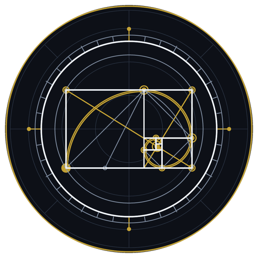
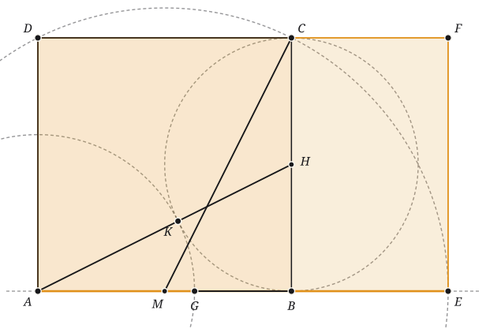

<a href="https://geometor.github.io/knott/"></a>

# GEOMETOR • knott

**Visit the Online Archive:** https://geometor.github.io/knott/

<p align="center">
  <a href="https://geometor.github.io/knott/"></a>
</p>

**Ron Knott • Fibonacci Numbers, Golden Section & Wythoff Geometry • semantic digital archive**

## Mission

`geometor/knott` is part of the interconnected [GEOMETOR](https://geometor.com) semantic digital archive. It provides an exact symbolic mathematical catalog formalizing the seminal research of Dr. Ron Knott across Fibonacci numbers, the Golden Section, base-$\Phi$ phigits, Sturmian golden strings, and Wythoff geometry. By translating these computational discoveries into verified SymPy algebraic certificates, 2D/3D models, and theme-adaptive vector diagrams, the repository establishes an interconnected bridge uniting modern discrete mathematics with classical Euclidean and polyhedral traditions across the GEOMETOR corpus.

## Catalogs in This Archive

- [Mathematical Catalog of Fibonacci Numbers and the Golden Section](https://geometor.github.io/knott/catalog/) — 22 machine-verified catalog items across six thematic collections proved in exact radical algebra with original interactive vector diagrams.

## Repository Contents

- `docsrc/` — RST catalog tracks, monographs, and guides compiled by [PHOTON publish](https://github.com/photon-platform/publish).
- `resources/` — Curated mathematical manifests, metadata catalogs, and serialization registries.
- `src/geometor/knott/` — Exact symbolic models, phigit converters, golden string generators, and catalog verifiers.

## Local Build & Verification

```bash
publish build
uv run --no-sync pytest
```
## Part of the GEOMETOR Knowledge Archive

Explore all **74 Book Codices** and **11 Mathematical Catalogs** at https://geometor.com/books/.
