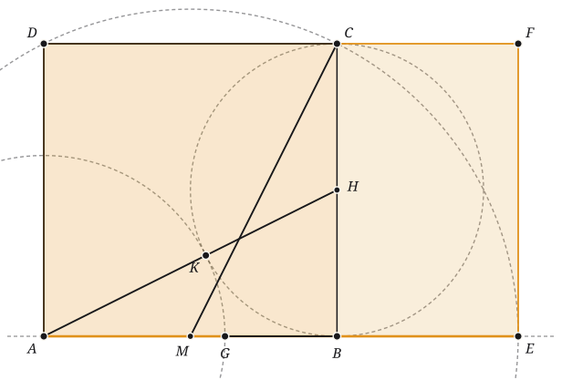

GEOMETOR • knott
================

**Visit the Online Archive:** https://geometor.github.io/knott/

**Ron Knott • Fibonacci Numbers, Golden Section & Wythoff Geometry • semantic digital archive**

Mission
-------

``geometor/knott`` is part of the interconnected `GEOMETOR <https://geometor.com>`_ semantic digital archive. It provides an exact symbolic mathematical catalog formalizing the seminal research of Dr. Ron Knott across Fibonacci numbers, the Golden Section, base-:math:`\Phi` phigits, Sturmian golden strings, and Wythoff geometry. By translating these computational discoveries into verified SymPy algebraic certificates, 2D/3D models, and theme-adaptive vector diagrams, the repository establishes an interconnected bridge uniting modern discrete mathematics with classical Euclidean and polyhedral traditions across the GEOMETOR corpus.

Catalogs in This Archive
------------------------

- `Mathematical Catalog of Fibonacci Numbers and the Golden Section <https://geometor.github.io/knott/catalog/>`_ — 22 machine-verified catalog items across six thematic collections proved in exact radical algebra with original interactive vector diagrams.

Python Package & Modules
------------------------

The ``geometor-knott`` Python package (``import geometor.knott``) provides the executable symbolic geometry, construction, and compilation modules powering this archive:

- ``catalog.py`` — Master registry of the 6 Collections and 22 Catalog Items (``KNOTT-1.1`` – ``KNOTT-6.5``).
- ``constants.py`` — Exact symbolic constants, notation bridges, and Rational Trigonometry invariants.
- ``expositions.py`` — Original GEOMETOR mathematical expositions and interactive ``:g:``/``:eq:`` bindings.
- ``flat_geometry.py`` — Collection 1: 2D Golden Geometry & Constructions (``KNOTT-1.1`` through ``KNOTT-1.6``).
- ``golden_string.py`` — Collection 5: The Golden String, Zeckendorf Base, & Wythoff / Stolarsky Arrays (``KNOTT-5.1`` – ``KNOTT-5.3``).
- ``identities.py`` — Collection 6: Fibonacci-Lucas Identities, Pythagorean Triples, Jigsaw Paradoxes & ``\pi`` (``KNOTT-6.1`` – ``KNOTT-6.5``).
- ``phigits.py`` — Collection 4: Algebraic Powers of ``\Phi``, Continued Fractions & Base-``\Phi`` "Phigits" (``KNOTT-4.1`` – ``KNOTT-4.3``).
- ``solid_geometry.py`` — Collection 3: 3D Golden Geometry of Solids (``KNOTT-3.1`` through ``KNOTT-3.3``).
- ``svg_renderer.py`` — Theme-adaptive ``.euclid-graphic`` SVG serializer for ``geometor.model.Model``.
- ``trigonometry.py`` — Collection 2: Exact Pentagonal & Constructible Trigonometry (``KNOTT-2.1`` – ``KNOTT-2.2``).

See the `API Reference <https://geometor.github.io/knott/modules/>`_ for full module documentation.

Repository Contents
-------------------

- ``docsrc/`` — RST catalog tracks, monographs, and guides compiled by `PHOTON publish <https://github.com/photon-platform/publish>`_.
- ``resources/`` — Curated mathematical manifests, metadata catalogs, and serialization registries.
- ``src/geometor/knott/`` — Exact symbolic models, phigit converters, golden string generators, and catalog verifiers.

Local Build & Verification
--------------------------

.. code-block:: bash

   publish build
   uv run --no-sync pytest

Part of the GEOMETOR Knowledge Archive
--------------------------------------

Explore all **74 Book Codices** and **11 Mathematical Catalogs** at https://geometor.com/books/.
