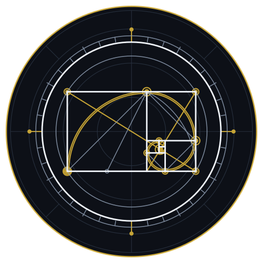

:site_title: Ron Knott

.. container:: author-overline

   semantic digital archive • mathematical catalog

=========
Ron Knott
=========

**Dr. Ron Knott** of the University of Surrey built the premier modern web compendium on Fibonacci numbers, the Golden Section :math:`\Phi`, base-:math:`\Phi` *phigits*, Sturmian golden strings, and Wythoff arrays. Where classical geometry meets discrete arithmetic, Knott traced every golden ratio thread from planar pentagrams and three-degree trigonometric lattices to 3D icosahedral coordinates and quasicrystals. This mathematical catalog translates his discoveries into **22 machine-certified symbolic models** over exact radical number fields with interactive vector plates.

Inside This Reference
---------------------

.. container:: home-book-hero

   .. container:: home-book-thumb plate-light

      .. image:: catalog/01-flat-geometry/02-golden-rectangles-and-spiral/knott-1-2.g1.svg
         :alt: Golden rectangle, root-5 rectangle, and whirling-square gnomonic spiral diagram
         :target: catalog/index.html

   .. container:: home-book-body

      .. rubric:: University of Surrey Archive · 6 Collections · 22 Certified Models

      **Mathematical Catalog of Fibonacci Numbers and the Golden Section** — Six thematic collections spanning planar golden constructions, exact pentagonal and :math:`3^\circ` trigonometry, orthogonal polyhedra, Bergman base-:math:`\Phi` phigits, Wythoff–Beatty arrays, and Fibonacci–Lucas identities.

      .. container:: home-actions

         * :doc:`Open Mathematical Catalog → <catalog/index>`
         * :doc:`Flat Geometry → <catalog/01-flat-geometry/index>`
         * :doc:`Phigits & Algebra → <catalog/04-phigits-and-algebra/index>`

Key Features
------------

.. container:: home-feature-grid

   .. container:: home-feature-card

      **22 Exact Radical Models**

      Every planar, trigonometric, and polyhedral structure is proved in exact SymPy algebra over :math:`\mathbb{Q}(\sqrt{5})` and cyclotomic extensions—never floating-point approximations.

   .. container:: home-feature-card

      **Phigits, Sturmian Words & Arrays**

      Explore Bergman's base-:math:`\Phi` numeral system, Zeckendorf representations, the infinite Golden String cutting-line slope, and Wythoff's complementary Beatty sequences.

   .. container:: home-feature-card

      **Interactive Euclid-Graphic Plates**

      Each catalog entry pairs symbolic verification with a dedicated ``.euclid-graphic`` vector diagram highlighting golden segments, gnomons, and recursive subdivisions.

Reference & Project
-------------------

.. container:: home-columns

   .. container:: home-col

      .. rubric:: Scholarly Apparatus

      * :doc:`People <people/index>` — Profiles of Ron Knott and historical contributors to Fibonacci and golden-ratio theory
      * :doc:`Bibliography <bibliography>` & :doc:`Notation <notation/index>` — Source references and algebraic conventions
      * :doc:`Glossary <glossary>` — Definitions of phigits, Zeckendorf bases, Penrose tiles, and Sturmian sequences

   .. container:: home-col

      .. rubric:: About This Project

      * :doc:`About <about/index>` & :doc:`Using This Edition <usage/index>` — Editorial scope, symbolic validators, and reading guide
      * :doc:`Python Modules <modules/index>` — Constructive SymPy validators, phigit converters, and golden string generators
      * :doc:`Project Log <log/index>` & :doc:`Changelog <changelog>` — Development records and release history

.. toctree::
   :hidden:
   :maxdepth: 2

   catalog/index
   people/index
   bibliography
   about/index
   notation/index
   usage/index
   log/index
   modules/index
   glossary
   changelog
